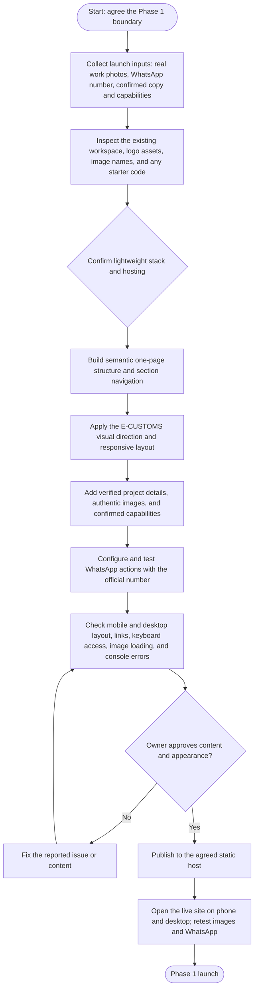

# E-CUSTOMS Phase 1 — Development Flow

## Delivery flow

## Work sequence and completion checks

### 1. Confirm inputs and boundaries

- Keep the work to a public showcase and WhatsApp contact.
- Obtain actual project photos, the official WhatsApp number, and confirmation of currently offered services.
- Confirm any extra contact/social details that should appear.
- Record remaining decisions: framework and hosting. TypeScript was inferred in the requirements; React has not been confirmed. GitHub Pages is a hosting preference to evaluate, not an already completed setup.

**Complete when:** no invented business information is required to build the first release.

### 2. Inspect and prepare assets

- Review the existing project structure before choosing or replacing any tooling.
- Select the approved logo file and test how it looks against the chosen background.
- Organize supplied work photos into descriptive filenames under `images/`.
- Optimize copies for web display while preserving the original files.
- Treat `Home Page sample.png` as a design reference only; it shows another workshop and is not E-CUSTOMS portfolio content.

**Complete when:** every image intended for the site has a known purpose, an accurate description, and permission for use.

### 3. Implement the page

- Build a single-page layout with clear section navigation.
- Use a small set of components or sections matching the visitor flow: hero, work, capabilities, process, about, contact, footer.
- Add project status labels and only verified project facts.
- Ensure the layout adapts to phone, tablet, and desktop sizes.

**Complete when:** all sections are readable and navigation works at common screen sizes.

### 4. Implement and verify contact actions

- Generate WhatsApp links from the official number; never hard-code a guessed number.
- Use a short, useful prefilled message if the owner approves it.
- Test that each contact action opens the correct WhatsApp conversation on phone and WhatsApp Web where available.

**Complete when:** every displayed contact action works and the number is confirmed.

### 5. Quality check and publish

- Check broken links, missing images, spelling, responsive behavior, keyboard navigation, and browser console errors.
- Confirm there are no placeholder prices, fake testimonials, or concepts labeled as completed work.
- Publish only after owner approval and access to the chosen host is available.
- Retest the live URL, images, and WhatsApp action after deployment.

**Complete when:** the live site displays correctly and prospective clients can reach E-CUSTOMS.

## One-day delivery reality

A one-day first release is plausible only if the owner supplies the essential photos, WhatsApp number, approved capability list, and hosting access promptly. If actual project photos or contact details are unavailable, the site can still be developed, but those sections must remain clearly marked as pending or be omitted before launch; they should not be filled with fabricated content.
