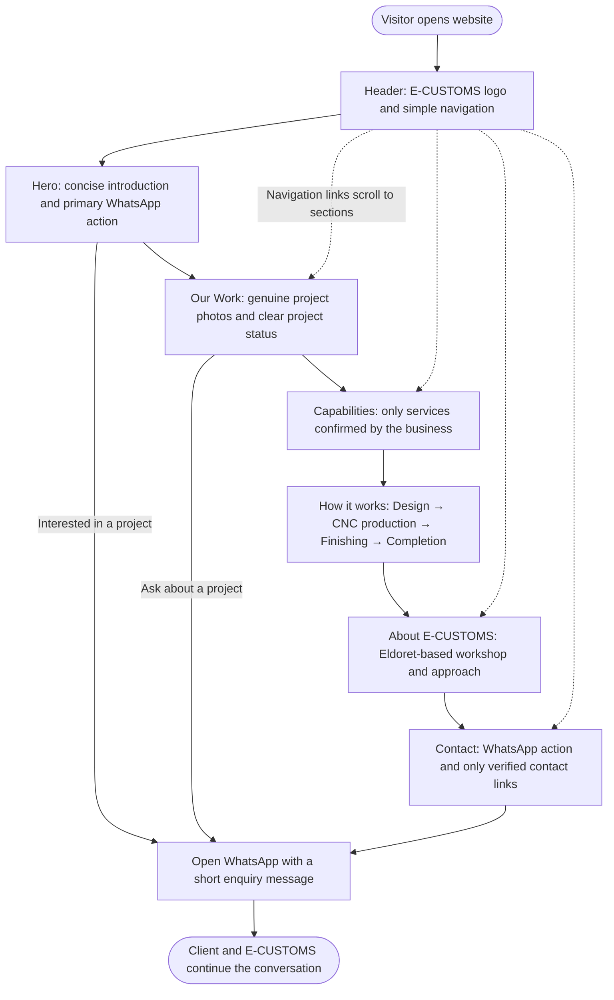

# E-CUSTOMS Phase 1 — Website and Visitor Flow

## Purpose

Phase 1 is a public, mobile-friendly digital showroom for E-CUSTOMS CNC Woodworks in Eldoret, Kenya. It helps prospective clients understand the workshop, see genuine work, learn about confirmed capabilities, and start a conversation through WhatsApp.

It is not an online shop or a customer-management system.

## Proposed one-page layout

### Page content and behavior

| Section | What the visitor sees | Important constraint |
|---|---|---|
| Header | Logo and short anchor navigation | Keep it simple and usable on small screens |
| Hero | What E-CUSTOMS does, a real workshop/product image if supplied, and a contact call to action | Do not imply services or results that have not been confirmed |
| Our Work | Project cards with photos, brief details, and status | Clearly distinguish completed work from work in development |
| Capabilities | Confirmed CNC, design, signage, or finishing capabilities | Treat the candidate service list as needing business confirmation |
| Process | Design, CNC production, finishing, completion | Describe the intended workflow, not a guarantee of turnaround |
| About | Short introduction to the Eldoret business | Avoid unverified history, credentials, or claims |
| Contact | WhatsApp and any other contact channel supplied by the owner | Do not publish placeholder or invented contact details |
| Footer | Brand and section links | No newsletter or data collection is needed for Phase 1 |

### Project status known so far

- **Completed:** CNC lion artwork, white MDF, 40 × 30 cm.
- **In development:** ergonomic wooden laptop stand. It must not be presented as a completed or currently purchasable product.

The project entry can be shown accurately once a genuine photo is supplied. Do not use reference images as evidence of E-CUSTOMS work.

## What Phase 1 entails

- A responsive public website with navigation, project presentation, business information, and contact actions.
- Static content and image files included with the website.
- A WhatsApp link configured from the real business number, optionally with a prefilled enquiry.
- Accessibility and performance basics: readable contrast, descriptive image text, keyboard-friendly links, and appropriately sized images.
- Static hosting can be considered; GitHub Pages is a candidate if a public repository and its publishing setup suit the owner.

## Explicitly out of scope

- Product checkout, shopping cart, pricing or inventory management.
- M-Pesa, card payments, or any other payment processing.
- Customer accounts, database, backend, or admin dashboard.
- Uploading or changing photos through a website interface.
- Enquiry form storage or automated order management.

For this phase, updating photos means replacing or adding files in the website project and publishing the updated site. A self-service admin upload workflow belongs to a later phase.

## Accuracy checks before public launch

1. Supply the official WhatsApp number in international format and test the resulting link.
2. Supply authentic photos of actual E-CUSTOMS work. The currently visible `images` contents include logo files and `Home Page sample.png`; that sample depicts another workshop and must not be presented as E-CUSTOMS work.
3. Confirm which capabilities are currently offered, versus ideas being explored.
4. Confirm the preferred public brand styling/name and any additional official contact or social links.
5. Decide the implementation approach and hosting. The requirements record TypeScript as an inference, while the framework and hosting details remain unconfirmed. A lightweight static implementation is likely sufficient for this no-backend scope.
